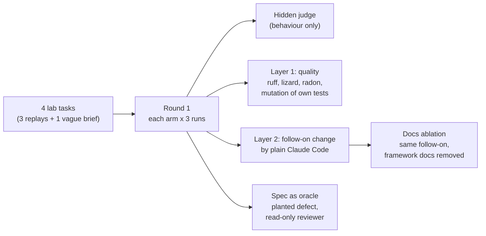

# Spec-Driven Development Frameworks: the measured bake-off (B86)

**Four spec-driven frameworks, AI-DLC (two versions), BMAD, OpenSpec and Spec Kit, measured against plain Claude Code on
this lab's own work.** This page replaces the 2026-08-11 desk evaluation (kept below as [History](#history-the-2026-08-11-desk-evaluation)),
which compared feature lists. The bake-off ran each framework on real lab tasks and judged the outcome, its quality, how
maintainable it was, and what its documents were worth.

> Measured 2026-10-31 to 2026-11-02, one model (Claude Opus 5.5): 72 judged implementation runs, 37 judged follow-on
> changes (24 with the framework's documents, 13 without) and 42 read-only reviews. Harness: `eval/sdd-bakeoff/`;
> runbook: [runbooks/sdd-frameworks.md](../runbooks/sdd-frameworks.md). Kiro stays excluded ($0 violation: managed AWS,
> Bedrock lock-in, capped free tier).

## Verdict

**No framework produced better results than plain Claude Code, and every one cost more.** Pass rate and code quality were
the same in every arm; only cost, time and the value of the documents differ.

| Arm | Cost vs plain | Wall time | Pass | Documents pay back the extra cost after | Use it for |
|---|---|---|---|---|---|
| **Plain Claude Code** | 1x | 1x | 12/12 | n/a | **The default.** |
| **OpenSpec** 1.16.0 | 1.35x | 1.05x (n.s.) | 11/12 | ~4 later changes | An area that will keep changing. Drive its apply step explicitly. |
| **Spec Kit** 1.2.5 | 1.6x | 1.6x | 12/12 | ~6 | Works; OpenSpec does the same job for less. |
| **BMAD** 6.12.4 | 2.6x | 2.1x | 12/12 | ~20 | Not worth it at this scale. |
| **AI-DLC** 2.6.18 (the lab's) | 4.6x | 3.1x | 11/12 | ~38 | Not worth it as a default; kept as a subject of study. |
| **AI-DLC** 2.11.2 (current release) | 10.9x | 6.3x | 12/12 | n/a | Not for this lab: 2.4x the cost of 2.6.18, 6-10 human approvals per change. |

Every cost and time effect is significant except the one marked n.s.: exact permutation test stratified by task, Holm-corrected
across the five framework arms. Pass rates do not differ (p = 1.0). No arm's own tests catch more planted mutations than
plain Claude Code's (best p = 0.19 after correction).

**For the selector (B86.1):** default to plain Claude Code; recommend OpenSpec when the PRD describes an area that will see
repeated change; recommend nothing heavier for lab-scale work. Those rules come from the table above, not from a model's
opinion (the B190 lesson). They are built: `scripts/select_sdd_framework.py` reads a prompt or PRD on the private lane
and applies `scripts/sdd-selector-rules.yaml` ([runbook](../runbooks/sdd-frameworks.md#pick-a-framework-for-a-project-the-selector-b861),
[flow](../diagrams/flow-sdd-selector.md)).

## The trial table

Every cell is 3 runs; passes are counted, the rest are medians over the cell. Generated by
`eval/sdd-bakeoff/cell_table.py` (also `results/cells.tsv` in the work dir). Cost is the USD equivalent the CLI
reports for the subscription's usage. **Questions** are framework questions put to a person: zero for every arm that
accepts the unattended "take the default" policy, and AI-DLC 2.11.2's gate replies. **Framework docs** are the
framework documents the trial authored.

| Task | Arm | Pass | Cost (USD equiv) | Wall (min) | Output tokens (k) | Questions | Framework docs |
|---|---|---|---|---|---|---|---|
| small | plain Claude Code | 3/3 | 0.48 | 2 | 7 | 0 | 0 |
| small | AI-DLC 2.6.18 | 3/3 | 3.53 | 7 | 48 | 0 | 12 |
| small | AI-DLC 2.11.2 | 3/3 | 9.41 | 14 | 84 | 6 | 24 |
| small | BMAD 6.12.4 | 3/3 | 1.29 | 4 | 21 | 0 | 0 |
| small | OpenSpec 1.16.0 | 3/3 | 0.87 | 2 | 12 | 0 | 6 |
| small | Spec Kit 1.2.5 | 3/3 | 1.06 | 4 | 17 | 0 | 8 |
| brown | plain Claude Code | 3/3 | 1.17 | 4 | 24 | 0 | 0 |
| brown | AI-DLC 2.6.18 | 3/3 | 4.95 | 19 | 75 | 0 | 12 |
| brown | AI-DLC 2.11.2 | 3/3 | 11.35 | 30 | 134 | 7 | 22 |
| brown | BMAD 6.12.4 | 3/3 | 2.45 | 15 | 46 | 0 | 2 |
| brown | OpenSpec 1.16.0 | 3/3 | 1.60 | 7 | 31 | 0 | 6 |
| brown | Spec Kit 1.2.5 | 3/3 | 1.79 | 5 | 35 | 0 | 8 |
| green | plain Claude Code | 3/3 | 1.17 | 4 | 21 | 0 | 0 |
| green | AI-DLC 2.6.18 | 3/3 | 5.11 | 11 | 74 | 0 | 12 |
| green | AI-DLC 2.11.2 | 3/3 | 10.99 | 22 | 126 | 8 | 22 |
| green | BMAD 6.12.4 | 3/3 | 2.10 | 6 | 35 | 0 | 2 |
| green | OpenSpec 1.16.0 | 3/3 | 1.80 | 5 | 29 | 0 | 6 |
| green | Spec Kit 1.2.5 | 3/3 | 1.88 | 5 | 32 | 0 | 8 |
| vague | plain Claude Code | 3/3 | 1.88 | 14 | 33 | 0 | 0 |
| vague | AI-DLC 2.6.18 | 2/3 | 6.43 | 28 | 93 | 0 | 13 |
| vague | AI-DLC 2.11.2 | 3/3 | 15.61 | 46 | 168 | 8 | 22 |
| vague | BMAD 6.12.4 | 3/3 | 6.76 | 19 | 115 | 0 | 2 |
| vague | OpenSpec 1.16.0 | 2/3 | 1.94 | 5 | 33 | 0 | 6 |
| vague | Spec Kit 1.2.5 | 3/3 | 2.54 | 14 | 40 | 0 | 8 |

The two failures:
- **vague / AI-DLC 2.6.18:** its tests use a GNU-only `sed` form that the CI image's BusyBox doesn't support, so its
  CI step goes red.
- **vague / OpenSpec:** stopped after the propose step without implementing.

BMAD's 0 to 2 documents reflect its quick path: on the small task it wrote none.

## The four questions B86 asked

1. **Per task shape, which arm delivers a passing result at the lowest cost?** Plain Claude Code on all four: the small
   fix, the brownfield feature, the greenfield service and the vague brief. OpenSpec is the cheapest framework on every
   shape, and on the vague brief it comes within 3% of plain Claude Code (1.94 vs 1.88).
2. **Where does a framework's overhead not pay off?** Everywhere at this scale. The overhead buys documents, and the
   documents save about 12% on each later change. That pays back only for OpenSpec (after ~4 changes) and Spec Kit
   (~6) on an area that keeps changing.
3. **Which project facts change the winner?** In this data, none changed it: plain Claude Code won every shape. Two facts
   change the cost of being wrong:
   - **Size and vagueness** multiply the heavy frameworks' overhead: BMAD went from 2.7x on the small fix to 3.6x on
     the vague brief.
   - **Expected future change** is the only fact that earns documents back.

   For the selector, those are the features: expected change frequency first, then size.
4. **Does AI-DLC's scope cover small-to-large well enough to make a second framework redundant?** No, in the other
   direction. On the small fix it auto-selected its lightest scope, `bugfix`, in all 3 runs, and still cost 7x plain
   Claude Code on a two-file change (3.53 vs 0.48). A second,
   lighter framework (OpenSpec) is the one worth keeping for spec-worthy work.

## How it was measured

- **Tasks** (each rebuilt from a `git archive` of the commit before the real fix, so no later commit is visible):
  - **small:** the alert-rules.bats PyYAML hex guard.
  - **brown:** the B234 private-lane guard and its aliases.
  - **green:** the store-scaler service, built from nothing.
  - **vague:** a two-sentence brief ("accept expiries").
- **Arms:** each framework installed by its own installer at a pinned version, plus plain Claude Code. Same model, task
  text, caps, unattended answer policy and sandbox for every arm. The sandbox gives each trial a fresh config dir, no MCP
  servers, no read access to the lab repo or home dirs, and a registry-only network allowlist.
- **Judging:** hidden reference judges, validated to pass the real solution and fail the base. They check behaviour and
  exit codes, never wording. The vague judge is reason-aware: a planted expiry counts as caught only when the failing check
  names it.
- **Replication:** 3 runs per cell (60 runs across the five original arms, 12 more for AI-DLC 2.11.2), run 2 at a time in
  a seeded shuffled order, so no arm always ran first or last.
- **AI-DLC 2.11.2** refuses a standing "take the default" instruction: its guard takes an answer only from a real human
  turn. It ran under a click-through driver that resumes the session with "Yes - take the recommended option" at each gate.
  That is how 2.11 is meant to be used, but it is a different protocol from the other arms.

## What the documents are worth

| Measure | Result |
|---|---|
| **Docs ablation** (13 valid pairs) | The same follow-on change, by plain Claude Code, cost **12% more** without the framework's documents (geometric mean, exact sign-flip p = 0.04). Every follow-on passed either way. |
| **Spec as oracle v1** (36 reviews) | A read-only reviewer found a planted single-site defect in **36/36** cases, with or without documents. Framework documents were opened in 1 review. |
| **Spec as oracle v2** (intent defects) | A mechanical rule found only 3 of 16 outputs where a value could be changed consistently in code and tests, and only 1 was valid. All 6 reviews found the defect without documents. |

The oracle result says something about this repo, not only the frameworks: the intended values also live in shared config,
fixtures, runbooks and committed rules, so a framework's documents are never the only record of intent. Their measurable
value here is the 12% saving on later changes: about $0.10 per change, against $0.38 to $3.83 of extra cost up front.

## Findings beyond the scores

- **OpenSpec's propose step can halt unattended work.** In 1 of its 12 valid runs (and 1 run later archived for the
  Node 18 crash) the agent read `/opsx:propose` as "planning only" and stopped before implementing, despite the
  instruction to continue. Name the apply step explicitly.
- **Runtimes matter and fail silently.** OpenSpec 1.16.0 needs Node 22.12 or later; on Node 18 `openspec new change`
  crashed in every run, and the agents worked around it by hand. AI-DLC needs `bun`, and BMAD needs `uv`. A trial whose
  framework engine never ran still passes, so prove the engine ran before reading a result.
- **OpenSpec sends anonymous usage telemetry by default.** Its CLI says so on first use (opt out with
  `OPENSPEC_TELEMETRY=0`). The trial sandbox's network allowlist blocked it; anywhere private PRDs are involved (the
  B86.1 selector), set the opt-out.
- **AI-DLC 2.11 is built for a person at the keyboard.** Its human-turn guard is a feature (the plan you approve is the plan
  that runs), and `AIDLC_UNATTENDED=1` does not lift it; it only stops automated prompts counting as a person.
- **Quality is a property of the model, not the framework.** Mutation scores of the trials' own tests ran 0.78 to 1.0,
  with every arm's range overlapping plain Claude Code's (0.83 to 1.0) and no significant difference. In round 1 Spec Kit
  produced the most complex code and BMAD the lowest maintainability index on the vague task; those two were observed,
  not tested for significance.

## Threats to validity

- **One model, lab-scale tasks:** 4 tasks, the largest a small service. A framework built for multi-team, multi-week
  delivery could earn its overhead on work this bake-off does not contain.
- **Small cells:** 3 runs per cell. Pass rates sit near the ceiling, so the bake-off can't show a framework raising them.
- **Docs ablation, one run per pair:** every docs-kept follow-on ran earlier in the day than its docs-removed twin.
- **Different protocol for AI-DLC 2.11.2:** each gate reply resumes the session, which may add cost of its own.
- **Harness errors found and fixed during the run**, each archived under the work dir's `invalid/` with its reason:
  - OpenSpec's Node 18 crash.
  - The missing runtimes.
  - A contaminated first ablation, whose repos already held the answer.
  - The 2.11 driver over-replying after a final status.

## History: the 2026-08-11 desk evaluation

Before the bake-off, B86 compared the frameworks' feature lists against the lab's then-workflow (the bespoke "Method",
retired for AI-DLC v2 in B133). Its core finding was **coverage asymmetry**: OpenSpec, Spec Kit, BMAD and Kiro are
*coding workflows* in the requirements-to-implementation band, while AI-DLC is a *delivery lifecycle* that also owns
discovery (whether to build) and operations (learn, then loop back). Its recommendation was to keep AI-DLC as the spine and
borrow artifact notations: delta specs (OpenSpec), a checkable constitution (Spec Kit), EARS requirements (Kiro), and
context-engineered unit files (BMAD).

The bake-off measured what that desk evaluation could only infer. The coverage asymmetry is real, and on lab-scale work it
is overhead: none of the extra lifecycle produced a better outcome. **"Keep AI-DLC as the spine" is withdrawn as a default.**
Use plain Claude Code, use OpenSpec where specs pay back, and keep AI-DLC as a studied framework
([runbooks/aidlc-workflow.md § Version policy](../runbooks/aidlc-workflow.md#version-policy-the-lab-stays-on-2618-other-versions-live-beside-it-decided-2026-11-02-b86)).

| | Origin | License / cost | Self-host |
|---|---|---|---|
| **AWS AI-DLC v2** | awslabs/aidlc-workflows | Apache-2.0, $0 | yes (local `.claude/` + `bun`) |
| **OpenSpec** | Fission-AI | MIT, $0 | yes |
| **GitHub Spec Kit** | GitHub | MIT, $0 | yes |
| **BMAD-METHOD** | BMad Code, LLC | MIT, $0 | yes |
| **Kiro** | AWS | paid tiers, Bedrock-locked | no (excluded) |

Related memory: [[spec-driven-frameworks-b86]], [[aidlc-version-policy]], [[bakeoff-framework-runtime-missing]],
[[bakeoff-derived-repo-contamination]]. Backlog: B86 (this evaluation), B86.1 (the selector), B133 (the v2 migration).
