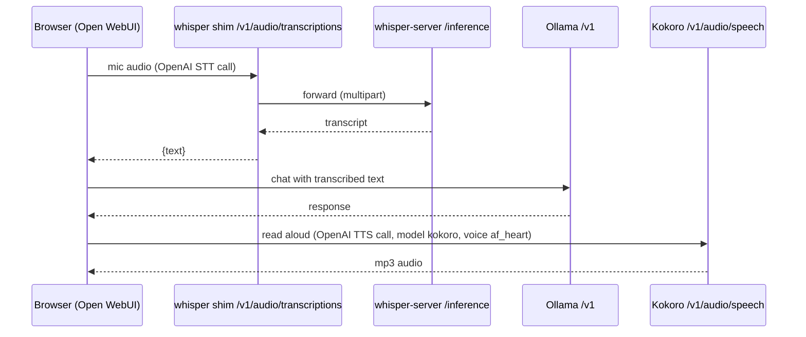

# Demo — Voice Chat (Open WebUI + whisper STT + Kokoro TTS)

Speak into the browser, have on-LAN whisper.cpp transcribe it, and chat with a local Ollama model —
zero cloud STT, all on the lab. Open WebUI uses **Ollama for chat** and the **whisper shim for
voice-in** via its OpenAI-compatible Audio→STT setting, and **Kokoro for read-aloud** (Audio→TTS, B246).

Grounded in [runbooks/transcription-whisper.md](../runbooks/transcription-whisper.md) and
[diagrams/flow-voice-chat.md](../diagrams/flow-voice-chat.md).

## Sequence diagram

Reused from [diagrams/flow-voice-chat.md](../diagrams/flow-voice-chat.md):



## Prerequisites

- **whisper** (k8s app `whisper` on timberback's GPU since 2026-11-14, B134; it ran on CT 103 before) — `whisper-server`
  (native `/inference` @ `:8080`) + the OpenAI shim (`/v1` @ `:9000`), two containers in one pod, in-cluster at
  `whisper.weyland.svc`. Model `ggml-large-v3` on CUDA.
- **rogueone** (`192.168.1.230`) — Ollama at `ollama.weyland.lab:11434` for chat.
- **mother** (`192.168.1.243`) — Open WebUI on k3s (manifests `k8s/open-webui/`), fronted by Traefik.
- A browser that can reach `chat.weyland.lab` with a working microphone.

## UI walkthrough

1. Open **`https://chat.weyland.lab`** (Keycloak SSO / OIDC — log in as `emangini`).
2. Confirm STT is wired: **Settings → Audio → Speech-to-Text (STT)** set to an OpenAI-compatible
   endpoint with base URL **`http://whisper.weyland.svc.cluster.local:9000/v1`** + any dummy API key
   (`scripts/open_webui_curate.py --check` reports it as curated).
3. In a chat, pick an Ollama model, click the **microphone**, speak a prompt, and stop recording.
   Open WebUI POSTs the audio to the shim's `/v1/audio/transcriptions`; the transcript fills the
   composer.
4. Send it — the model answers over the local Ollama endpoint.
5. Confirm TTS is wired: **Settings → Audio → Text-to-Speech (TTS)** shows engine OpenAI, base URL
   **`http://kokoro.weyland.svc.cluster.local:8880/v1`**, model `kokoro`, voice `af_heart` (B246; `--check` reports
   it as curated). Under the answer, click **Read Aloud** (the speaker icon): the reply is spoken in Kokoro's voice.
   Long replies are split at punctuation, so the first sentence plays while the rest is synthesized.

## CLI walkthrough

Verify the shim end-to-end from rogueone through the `whisper-lan` NodePort on timberback (`.233`; a Local-policy
port, so it answers on the pod's node), using the JFK sample in the repo:

[rogueone]
```
curl -s http://192.168.1.233:30901/v1/audio/transcriptions -F file=@/home/edwardmangini/IdeaProjects/weyland/nodes/mother/lab/weyland-platform/services/whisper-cuda/jfk.wav -F model=whisper-1 -F response_format=json
```

Expect (run 2026-11-17): `{"text":"And so my fellow Americans, ask not what your country can do for you, ask what you can do for your country."}`

Verify the native whisper-server path the shim forwards to (port 30881):

[rogueone]
```
curl -s http://192.168.1.233:30881/inference -F file=@/home/edwardmangini/IdeaProjects/weyland/nodes/mother/lab/weyland-platform/services/whisper-cuda/jfk.wav -F response_format=json
```

Expect a `{"text": ...}` JSON reply with the known words. The 2026-11-17 wrong decode here ("but what your country can
do for you") was not about the missing shim parameters: on 2026-11-19 BOTH paths decoded the same request differently
run to run on the GPU. Prove it is stable with the runbook's check (30 runs, every one right):

[rogueone]
```
bash /home/edwardmangini/IdeaProjects/weyland/scripts/whisper-stability-check.sh http://192.168.1.233:30881/inference 30
```

Confirm the pod is up on timberback (both containers, `whisper-server` and the shim):

[rogueone]
```
kubectl -n weyland get pods -l app=whisper -o wide
```

Expect one pod, `2/2 Running`, on node `timberback`.

Confirm the chat backend (Ollama) is reachable from the LAN:

```
[rogueone] curl -s http://ollama.weyland.lab:11434/v1/models
```

## Expected result

- Shim returns strict `{"text":" And so my fellow Americans, ask not what your country can do for
  you..."}` (the shim builds the JSON itself so Open WebUI never sees shape drift).
- In the browser, spoken input becomes composer text, and the local model replies — the voice→text→
  chat loop closes with nothing leaving the LAN.
- Read Aloud speaks the reply in the `af_heart` voice from the lab's Kokoro, not the browser's built-in voice.

## Cleanup / teardown

Largely **read-only** — transcription and inference create no persistent lab artifacts. The only
state is your Open WebUI **chat conversation**, which you can delete in-app (chat list → delete
conversation). The whisper services stay running (they are the live B13 consumer); no teardown
needed.
