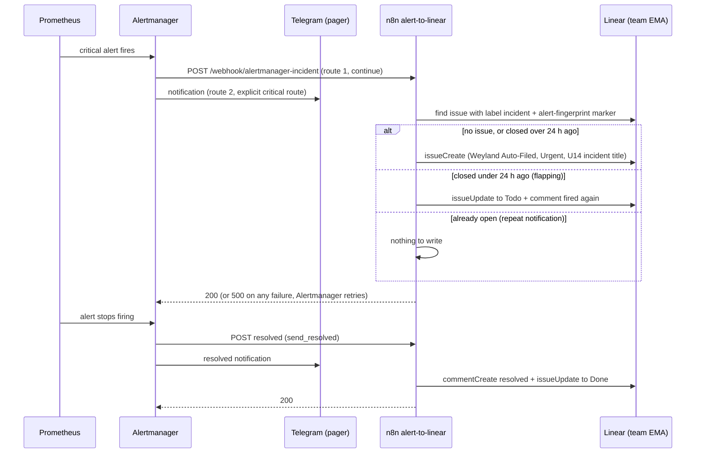

# Flow: Alert → Linear incident (U14)

A critical alert pages Telegram as before and also becomes a Linear issue, so the estate keeps a record of every
incident: when it fired, when it resolved, and whether it came back. One issue per alert fingerprint. Runbook:
[alert-to-linear.md](../runbooks/alert-to-linear.md).

- **Two routes, not one.** A matching Alertmanager child route claims the alert even with `continue: true`, so the
  incident route is followed by an explicit critical → Telegram route; otherwise Telegram would stop paging criticals.
  Proven with `amtool config routes test` (`linear-incidents,telegram` for critical, `telegram` for warning).
- **Fails closed.** Linear answers a refused GraphQL write with HTTP 200, so the workflow checks every write's
  `success` and answers 500 if any failed; Alertmanager retries and `AlertmanagerFailedToSendAlerts` reaches Telegram.
- **Only Traefik and Alertmanager can reach n8n** (NetworkPolicy `n8n-front-door-only`): n8n webhooks carry no auth.
