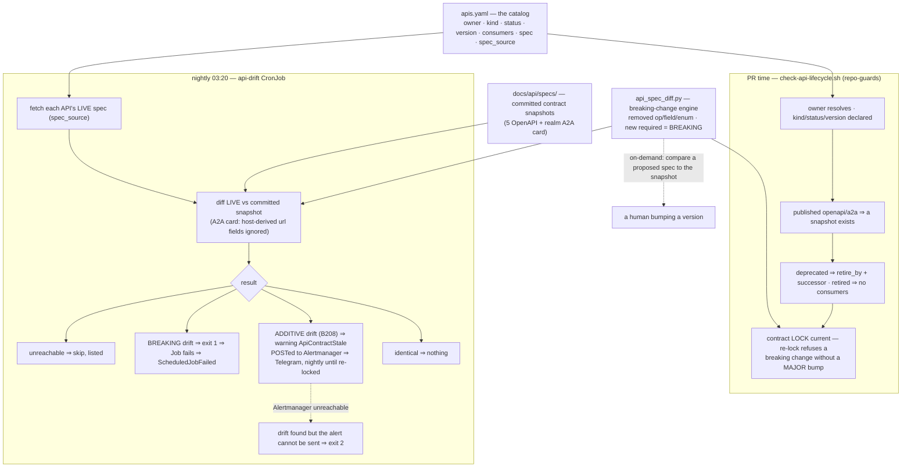
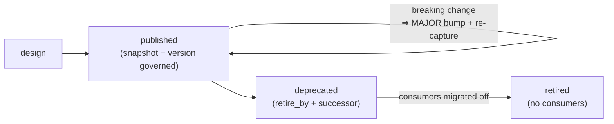

# Flow — API lifecycle governance (B155 · B208)

The estate's APIs are governed across their whole lifecycle from one catalog (`apis.yaml`): a PR-time
lifecycle guard + a runtime drift cron, both over the same catalog + committed contract snapshots, with
one breaking-change engine. Concept: [api-lifecycle.md](../concepts/api-lifecycle.md); demo:
[api-lifecycle.md](../demos/api-lifecycle.md). The `api-drift` CronJob is modelled in LikeC4 as
`apiDrift` (obs group); the CI guard + engine are repo tooling (LikeC4 N/A).

## Two enforcement points, one catalog + one engine

## Lifecycle stages the catalog governs

- **One catalog, two enforcement points:** the lifecycle guard governs the *declaration* at PR time; the
  drift cron governs the *deployed reality* nightly. Both read `apis.yaml`; both fail-closed.
- **The engine is the objective arbiter of "breaking", at BOTH enforcement points:** at PR time the
  contract lock diffs the changed snapshot against its approved baseline and refuses a breaking change
  without a major bump (a merge gate); nightly the drift cron diffs the live spec against the snapshot.
  It never guesses — an unknown/mismatched pair is *cannot-compare*, not a silent pass.
- **Additive drift is named, not passed (B208, 2026-10-13).** Before B208 the cron exited 0 on any non-breaking
  difference, so the tool-server served a `langfuse` field for two weeks its snapshot lacked. Now each additive
  difference raises a `warning` `ApiContractStale` alert (re-sent nightly until the snapshot is refreshed and re-locked),
  and a finding that cannot be delivered fails the Job (exit 2): a finding nobody hears is not reported. Runbook:
  [api-lifecycle.md](../runbooks/api-lifecycle.md).
- **Honest scope:** only typed contracts (OpenAPI/A2A) get snapshots + drift detection; MCP/OpenAI-shape
  APIs are catalogued (owner/version/status) but not yet snapshotted, and the guard says so.
