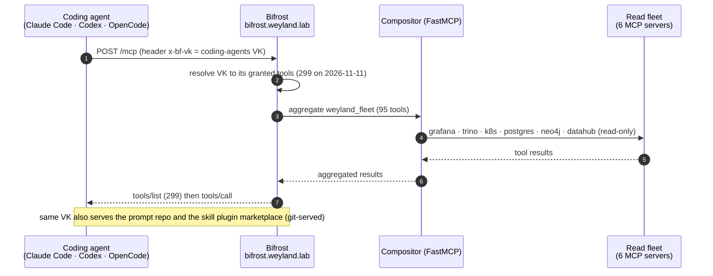
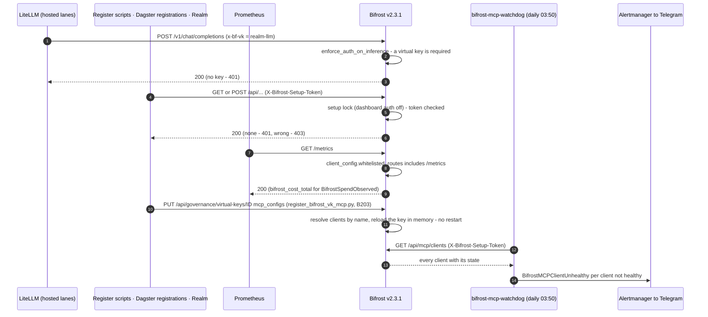
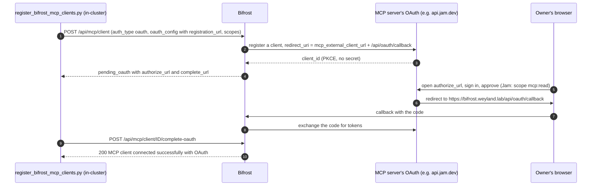

# Flow: Bifrost — agent MCP edge (B17+B19 / B111)

Bifrost (`bifrost.weyland.lab`) is the coding-agent front door: one `coding-agents` virtual key exposes the
MCP surface (the read fleet via the FastMCP compositor + external MCPs), the prompt repository, and the
skill plugin marketplace (live counts: the nightly `bifrost-backup` log line, `runbooks/mcp-gateway.md`) — the same VK across Claude Code, Codex, and OpenCode.

## Who authenticates how (since v2.2.6, B202 — 2026-10-09; unchanged on v2.3.1, B231)

## An OAuth MCP client (Jam, Linear, Hugging Face) — dynamic client registration (B192, 2026-11-11)

`mcp_external_client_url` must be the public URL: unset, Bifrost takes the request Host header, and the registrar runs
in-cluster, so the callback became `bifrost.weyland.svc.cluster.local` (found 2026-11-11). Which tools a key then sees is
set separately per key (`register_bifrost_vk_mcp.py`; Jam: read tools only).

The five settings (with `skills_external_client_url`, B241, and `mcp_external_client_url`, B192) live in `config.db` and are restored by `register_bifrost_client_config.py`; VK→MCP scoping by `register_bifrost_vk_mcp.py` (B203); the token is the sealed
`bifrost-setup-token` Secret (runbook § Bifrost setup token).

**Read-only fleet;** write/act tools live on the separate `/mcp-act` mount (Keycloak-authed, `policy.gate`).
Demo: [demos/bifrost.md](../demos/bifrost.md). Runbook: [runbooks/mcp-gateway.md](../runbooks/mcp-gateway.md).
