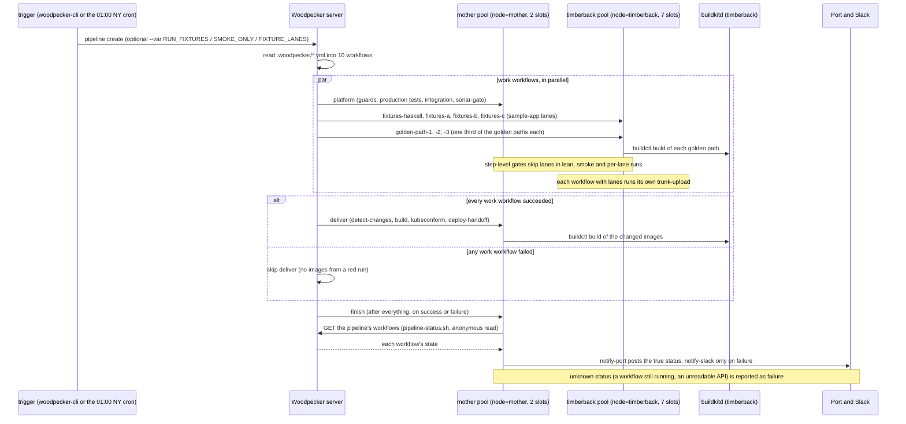

# Flow: weyland-lab CI — ten workflows on two agent pools (B200)

How one weyland-lab pipeline runs since B200 (2026-11-18/19). Woodpecker reads every `*.yml` in `.woodpecker/` as a
workflow of the same pipeline. Each workflow names its agent pool by label: an agent takes a workflow only if it carries
every label the workflow lists. mother's pool (2 agents, 1 slot each) runs `platform`, `deliver` and `finish`;
timberback's pool (1 agent, 7 slots) runs the four `fixtures-*` workflows and the three `golden-path-*` shards, all at
once. Each workflow has its own workspace, and its step pods are pinned to its pool's node, so its caches are on the same
node. `deliver` waits for every work workflow and is skipped if one failed. `finish` waits for everything and reads the
pipeline's true status from the API, because a workflow's own `$CI_PIPELINE_STATUS` sees only that workflow.
Layout and rules: `.woodpecker/README.md`. Design: [arch.md §10m](../arch.md). Runbook: [woodpecker.md](../runbooks/woodpecker.md).

Last proven 2026-11-19: full CI #692 green in 17 min 37 s, all seven timberback workflows at once. CI #689/#690 failed
in one workflow each: `deliver` was skipped and `finish` posted `failure` to Port and Slack.
