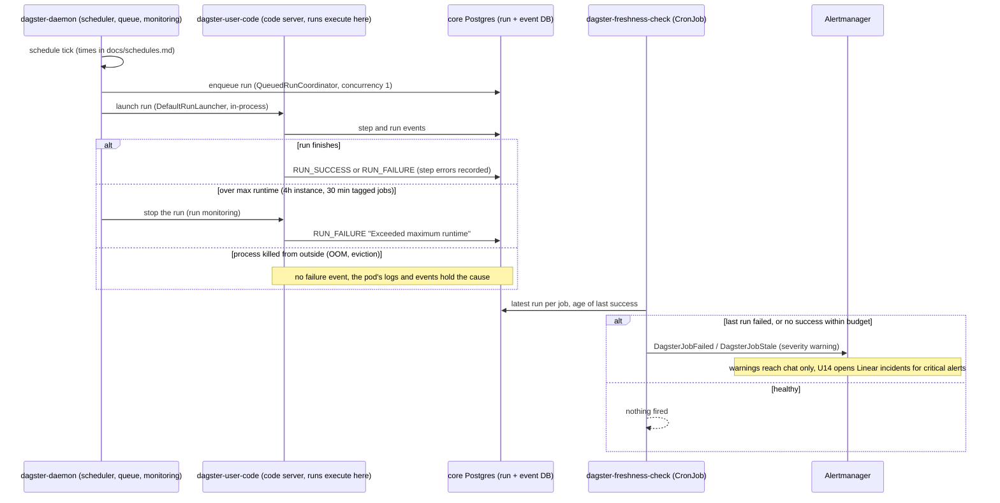

# Flow — a scheduled Dagster run, its limits and its watchdog (B239)

How a scheduled job runs and how a failure becomes visible. Runs execute inside the user-code pod, one at a time, and
a failure reaches people only as a warning. Operate: [runbooks/dagster.md](../runbooks/dagster.md).

- **Explain a failure:** `scripts/lib/dagster_runs.py` (runbook § Why did a run fail?) reads the same run and event
  records the UI shows.
- **A CLI `dagster job execute` run never reaches the run DB,** so this whole flow, the watchdog included, never sees it.
