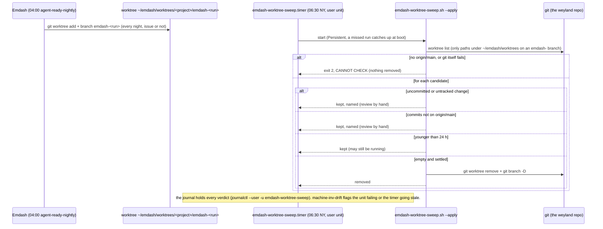

# Flow — the Emdash worktree sweep (B179, 2026-10-22)

Every nightly `agent-ready-nightly` run opens a git worktree and an `emdash-<run>` branch, even on a night with no
`agent-ready` issue, and nothing removed them (10 by 2026-10-22, all empty). A daily user timer on rogueone removes the
ones that hold nothing and names the rest. It never decides that work is disposable: only an empty, settled worktree
goes.

Runbook: [software-factory.md § Worktree sweep](../runbooks/software-factory.md). Logic:
`scripts/emdash-worktree-sweep.sh` (tests: `scripts/tests/emdash-worktree-sweep.bats`, real git).

