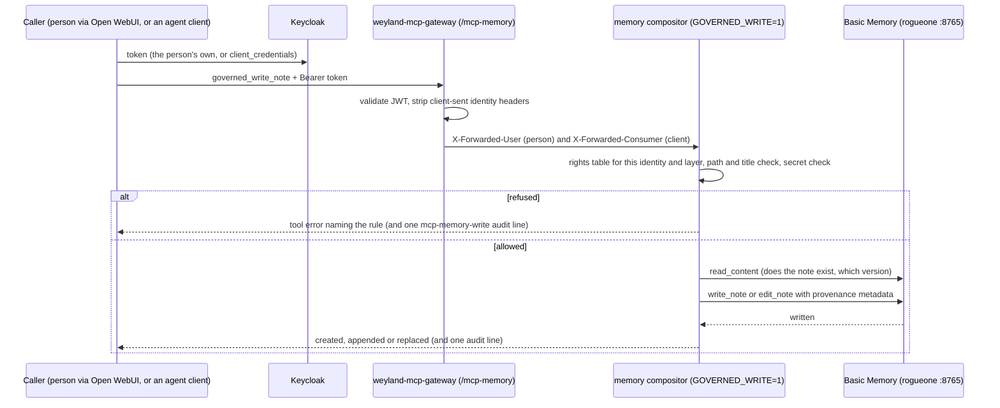

# Flow: a governed write to the shared memory (B256)

A person (through Open WebUI) or an agent (with its own Keycloak client) writes to the shared memory through the
governed gateway. The gateway sets the caller's identity from the validated token; the memory compositor decides, stamps
provenance and forwards to Basic Memory. Design: [shared-context-design.md](../design/shared-context-design.md);
runbook: [shared-agent-memory.md](../runbooks/shared-agent-memory.md); decision: [ADR-0019](../adr/0019-shared-context-layers-with-governed-writes.md).

