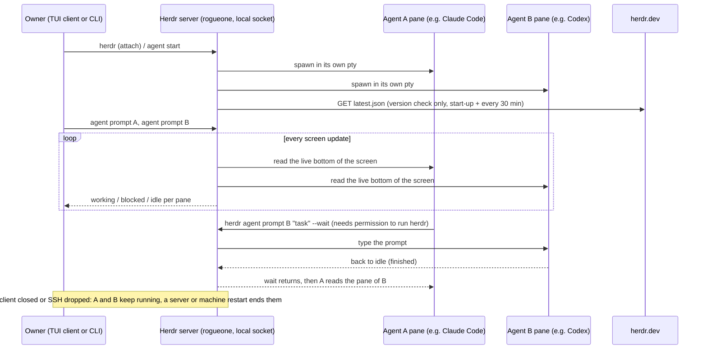

# Flow: several coding agents side by side in Herdr (B257)

Herdr's background server owns each agent's terminal, so the agents outlive the client (a closed terminal or a dropped
SSH connection). It reads each agent's state from its screen (or the agent's own reports) and serves a local socket
that the CLI, scripts and other agents use. Runbook: [herdr.md](../runbooks/herdr.md);
decision: [ADR-0018](../adr/0018-adopt-herdr-for-interactive-multi-agent-work.md).

