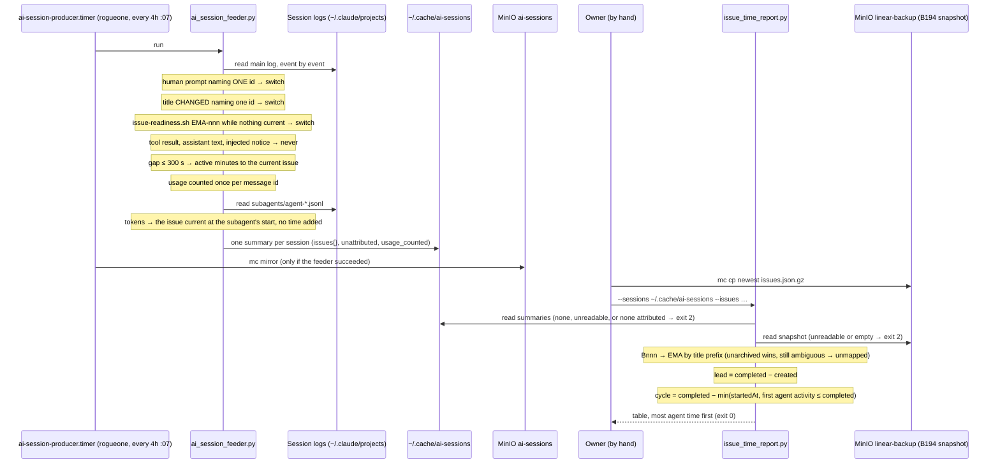

# Flow: time per Linear issue — attributing agent sessions (B185 lane 1, 2026-10-12)

The B62 producer on rogueone parses each Claude Code session and attributes its active time and tokens to the issue
the session was working on; `issue_time_report.py` joins that with the B194 Linear snapshot for lead and cycle time.
The marker rules are a decision table — why a tool result never switches, why an attended readiness call does not —
so they are drawn here. Runbook: [issue-time.md](../runbooks/issue-time.md).

