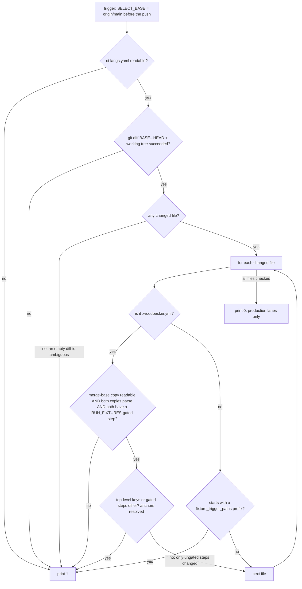
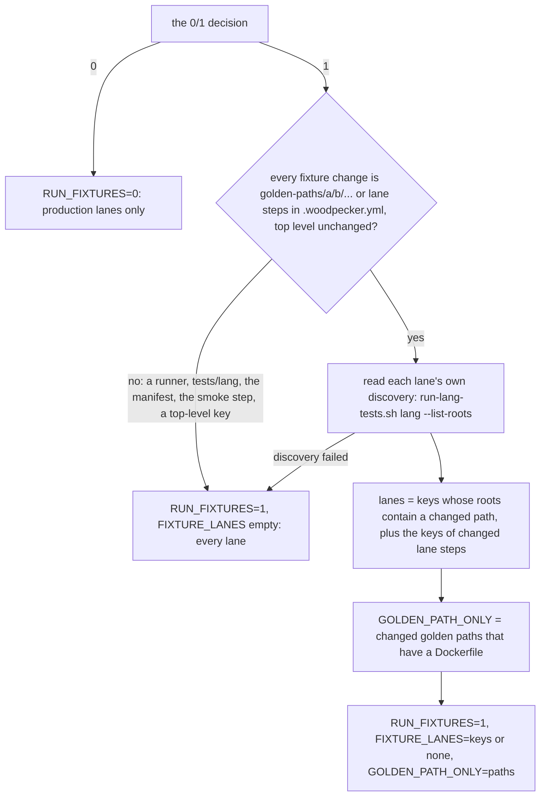
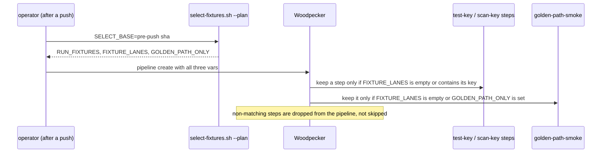

# Flow: the lean CI selector (B177, content-aware since 2026-10-16)

`scripts/ci/select-fixtures.sh` decides whether a pipeline runs the ~46 fixture-language lanes and the all-paths golden
smoke (`RUN_FIXTURES=1`, hours on the single node) or only the production lanes (`0`). The trigger passes its answer as
`woodpecker-cli pipeline create … --var RUN_FIXTURES=<n>`; an unset var runs everything.

**Fail-closed is the whole design:** `0` needs positive evidence that a change touched no fixture lane. Every path
that cannot produce that evidence prints `1`.

## Why `.woodpecker.yml` is compared by content

It defines the fixture lanes, so it must be a trigger. As a whole-file trigger it was too blunt: pipeline **#382**
(2026-10-16) ran the full matrix for hours because one line was added to `repo-guards`, a step every lean run executes
anyway. The selector now loads both copies with `yaml.safe_load` (which resolves the `&fixture` / `*skip_on_smoke`
anchors in place) and compares only what can change a fixture lane: every top-level key, and every step whose `when`
mentions `RUN_FIXTURES`.

| Change | Answer | Why |
|---|---|---|
| A line in an ungated step (`repo-guards`, `build`, `sonar-gate`) | `0` | That step runs in a lean pipeline too |
| A gated step's image, commands or `when` | `1` | It changes what a fixture lane does |
| A step gains or loses its gate | `1` | The set of gated steps differs |
| A top-level key (`labels`, `when`, a shared anchor) | `1` | It reaches every step |
| A base copy that is missing, unparseable, or has no gated step | `1` | Nothing to compare against is not "nothing changed" |
| `ci-langs.yaml` itself | `1` | Still a whole-file trigger: the manifest defines what lean means |

## Per-lane selection: `--plan` (2026-10-18, B224)

The `0`/`1` answer was all-or-nothing: a one-path Swift bump (#413) ran all 46 fixture lanes. `--plan` prints three
eval-safe assignments, and each fixture lane gates on its own key.

| Change | Plan |
|---|---|
| `golden-paths/swift/vapor-app/…` only | `FIXTURE_LANES='swift'`, `GOLDEN_PATH_ONLY='swift/vapor-app'` |
| `golden-paths/mobile/swift-ios/…` (a project the swift lane discovers, no Dockerfile) | `FIXTURE_LANES='swift'`, `GOLDEN_PATH_ONLY=''` (smoke skips) |
| `golden-paths/python/flask/…` (python is a production lane) | `FIXTURE_LANES='none'`, `GOLDEN_PATH_ONLY='python/flask'` |
| `test-swift` image bump in `.woodpecker.yml` + the swift golden path | `FIXTURE_LANES='swift'` (the #413 push, replayed) |
| Any shared trigger alongside | full: `FIXTURE_LANES=''` |

## Related

- [runbooks/woodpecker.md](../runbooks/woodpecker.md) § Lean language matrix — the trigger command
- `scripts/tests/ci-select-fixtures.bats` — 35 cases, including the real f9ac9ae1..d7ae173b push that tripped #382, the
  per-lane `--plan` cases, and a guard that every real fixture step gates on its own key
- [flow-weyland-image-ci.md](flow-weyland-image-ci.md) — the pipeline the answer feeds
