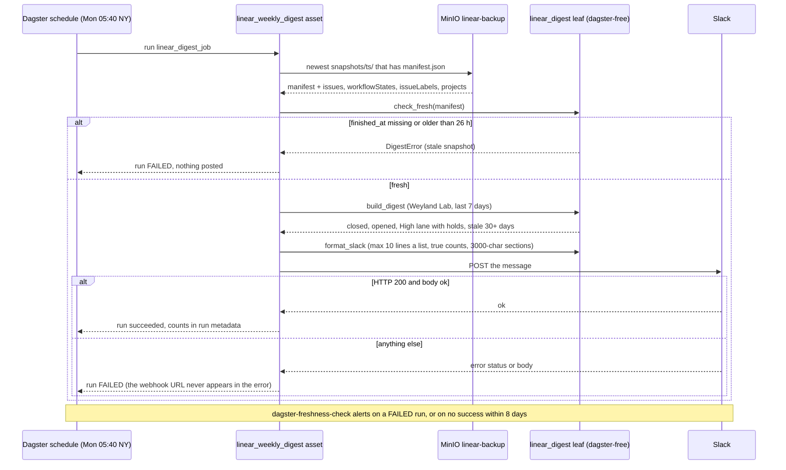

# Flow — weekly Linear digest to Slack (B237)

Every Monday at 05:40 NY, twenty minutes after the nightly Linear snapshot (B194,
[flow-linear-backup.md](flow-linear-backup.md)), Dagster reads the newest complete snapshot from MinIO and posts one
summary of the Weyland Lab board to Slack `#linear-updates`. It never calls the Linear API, so it needs no Linear
credential. Operate: [runbooks/linear-backup.md](../runbooks/linear-backup.md) § Weekly digest.

- **Fails closed.** A stale snapshot, a missing webhook Secret, an unknown project or any reply but `200 ok` fails the
  run; the freshness watchdog turns that into an alert. Stale numbers are never posted as this week's.
- **Weyland Lab only.** Issues from other projects (Stud.IO, Weyland Auto-Filed) never reach the counts.
- **A quiet week still posts**, with zero counts, so silence never means "the digest broke".
