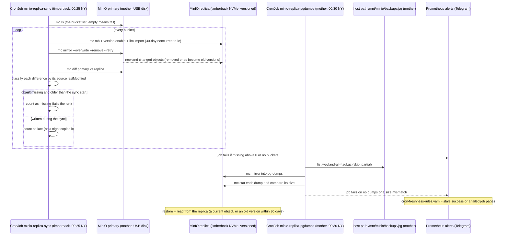

# Flow: MinIO replica on timberback — nightly copy, verify, and the dump files (B134)

How the lab's first backup on a second machine runs. Two CronJobs fill a versioned MinIO on timberback from the
primary on mother's USB disk. **`minio-replica-sync`** (00:25 NY, on timberback) mirrors every bucket and then checks
the result with `mc diff`. An object the replica lacks fails the run only if it predates the sync; writes that land
during the copy are counted and picked up the next night. **`minio-replica-pgdumps`** (00:30 NY, on mother) copies the
core Postgres dump files, which MinIO does not list, into the replica's `pg-dumps` bucket and checks each size.
Versioning plus a 30-day rule for old versions makes a bad delete or overwrite upstream recoverable for 30 days.
Design: [arch.md §10l](../arch.md). Runbook: [storage-minio.md § Replica](../runbooks/storage-minio.md).

Last proven 2026-11-17: the first full copy verified 22 buckets with 0 missing; the restore drill read a dump back
byte-identical, an old version of a deleted Loki object, and an MLflow artifact
([demos/backup-restore.md § MinIO replica](../demos/backup-restore.md)).
