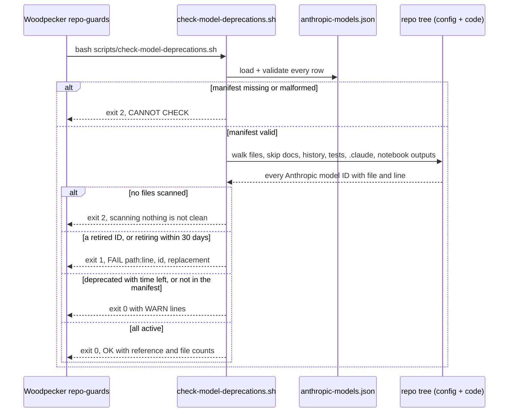
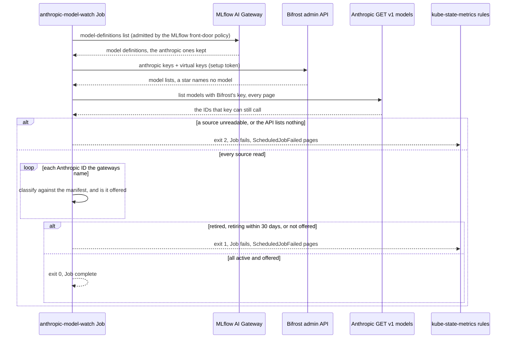

# Flow — Anthropic model deprecations (B223)

Two checks answer "does anything here use a model Anthropic is retiring?", both from one manifest
(`scripts/anthropic-models.json`, copied from Anthropic's deprecations page) and one script (`scripts/model_lifecycle.py`).
The **repo guard** runs in CI over what git holds. The **live check** runs nightly at 03:55 NY over what the gateways
hold in their own databases. Operate: [runbooks/model-deprecations.md](../runbooks/model-deprecations.md).

## Repo guard (every CI build)

## Live check (anthropic-model-watch, 03:55 NY)

