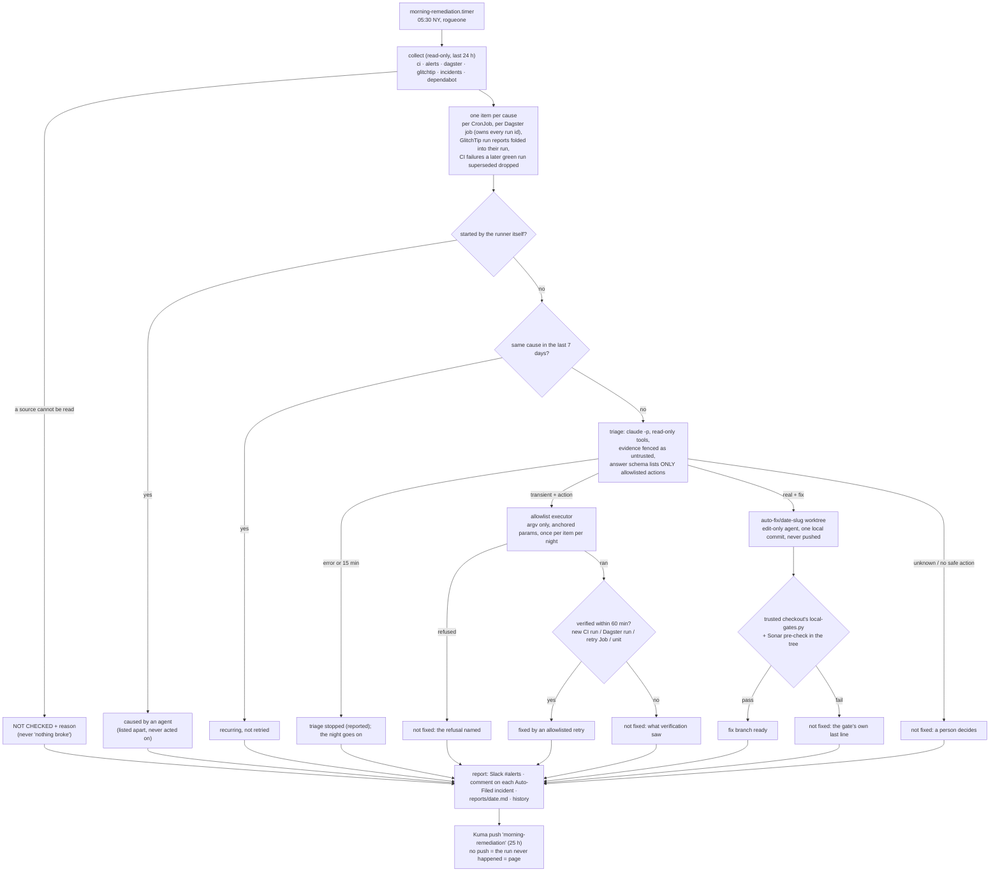

# Flow: morning remediation (B243)

Each morning at 05:30 NY a rogueone user timer collects what broke overnight, decides per item, acts only within the
owner-approved allowlist, and reports. Operate: [runbooks/morning-remediation.md](../runbooks/morning-remediation.md).
Proven on the seeded test night of 2026-11-24 ([demos/morning-remediation.md](../demos/morning-remediation.md)).

The safety lines, in order: triage can only read; the only actions are the four in `scripts/morning/allowlist.yaml`;
each runs once per item per night; nothing counts as fixed until verified; code changes stay on a local branch that the
trusted checkout's gates judged; the report never says more than was verified.
