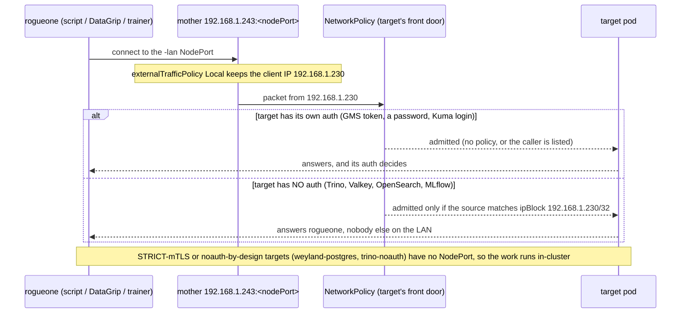
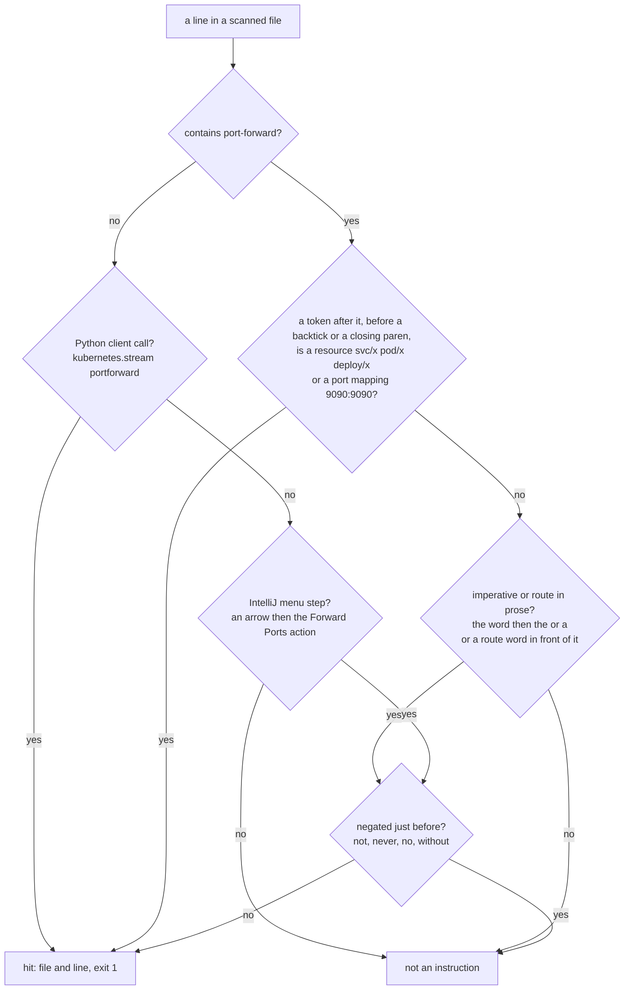

# Flow — LAN access: NodePorts only, and the guard that keeps it that way

How anything off the cluster reaches an in-cluster service, and how `scripts/check-no-port-forward.sh` decides that a
line in the repo is a port-forward instruction. Runbook: [lan-access.md](../runbooks/lan-access.md). Demo:
[no-port-forward.md](../demos/no-port-forward.md).

## Reaching a service from rogueone

## Is this line a port-forward instruction?

The scan itself fails closed: zero files scanned is exit 2 (a wrong root is "could not run", never "clean").
`docs/backlog.md`, notebooks (`.ipynb` outputs are recorded data), generated trees and the guard's own files are not
scanned.
