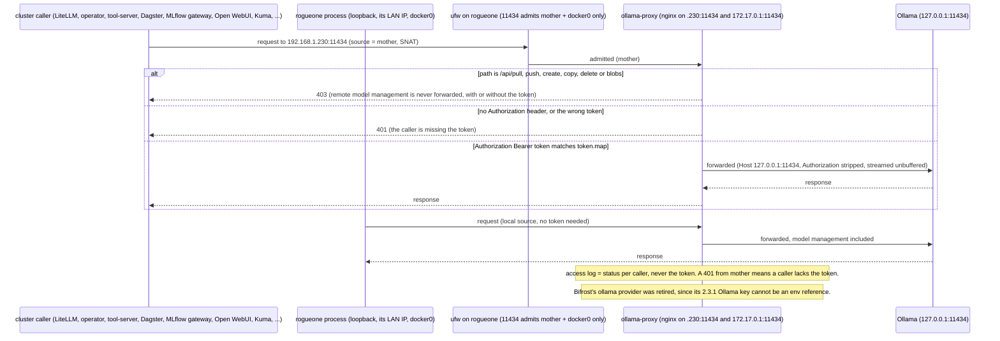

# Flow — the Ollama front door (B211, 2026-10-22)

Ollama has no authentication, and rogueone's firewall cannot tell one pod from another: every pod's traffic reaches
rogueone SNATed to mother's address. So Ollama binds `127.0.0.1:11434`, and `ollama-proxy.service` (nginx in Docker,
host network) owns `192.168.1.230:11434` and `172.17.0.1:11434`. A remote caller must present the bearer token
(`OLLAMA_PROXY_TOKEN` in `scripts/.env`, sealed as `ollama-proxy-token`, sent as `OLLAMA_API_KEY`). Model management is
refused to every remote caller, token or not. rogueone's own processes need no token.

Runbook: [model-serving-ollama.md § Front door](../runbooks/model-serving-ollama.md#front-door--token-proxy-b211-2026-10-22).
Config: `nodes/rogueone/ollama-proxy/`. Proof against a real Ollama: `nodes/rogueone/ollama-proxy/test-proxy.sh`.

**What each refusal means.**
- **401 from `192.168.1.243`** is a cluster caller without the token. Find it by user agent in the proxy log
  (`docker logs ollama-proxy`) and give it `OLLAMA_API_KEY` from `ollama-proxy-token`.
- **403** is a remote model-management call. Pull, create or delete models on rogueone itself (`ollama pull ...`).
- **The proxy not starting** is almost always the config with the real token map. Pre-flight it with the runbook's
  `nginx -t` step (the first live flip failed on the map hash bucket size, 2026-10-22).
