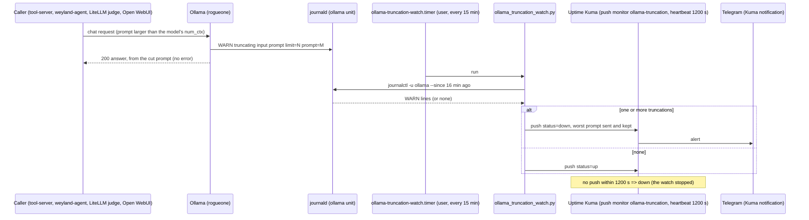

# Flow: Ollama truncation watch (B255)

Ollama cuts a prompt longer than the model's window without an error: the request succeeds, the closing log line even
reads `truncated = 0`, and only a `WARN ... truncating input prompt limit=N prompt=M` line in its journal says what was
lost. The watch reads those lines every 15 minutes and pushes the result to Uptime Kuma, which alerts on `down` and on a
missed heartbeat (the watch itself dead). Runbook: [model-serving-ollama.md § Truncation watch](../runbooks/model-serving-ollama.md);
script `scripts/ollama_truncation_watch.py`; units `nodes/rogueone/systemd/ollama-truncation-watch.{service,timer}`.

