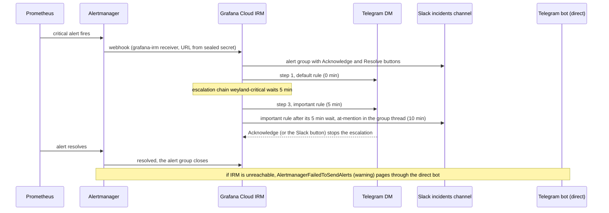

# Flow: on-call — a critical page escalates Telegram → Slack (B184 phase 2)

Critical alerts page through Grafana Cloud IRM (free tier). One responder; the escalation moves across channels until
someone acknowledges. Runbook: [on-call.md](../runbooks/on-call.md).

- **Outbound only.** Alertmanager calls Grafana Cloud. Slack's buttons call Grafana Cloud, never the LAN.
- **Proven 2026-11-05:** Telegram 1:46, Telegram 1:51, Slack @mention 1:56 (EST). See
  [demos/slack.md](../demos/slack.md) § 3.
