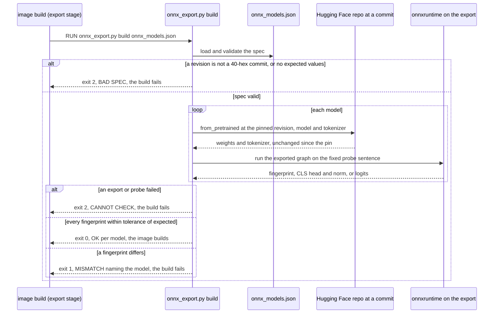

# Flow — pinned ONNX exports (B216)

Every image that bakes an ONNX model exports it at a pinned Hugging Face commit and proves, inside its own build, that
the export reproduces the output recorded from the deployed model. Operate: [runbooks/onnx-models.md](../runbooks/onnx-models.md).

