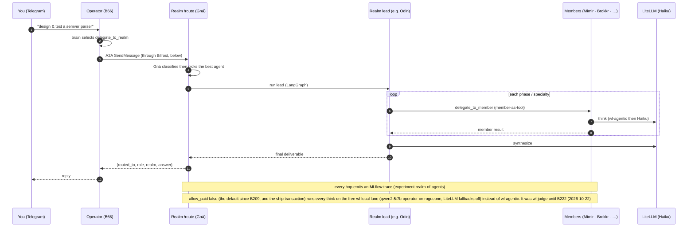
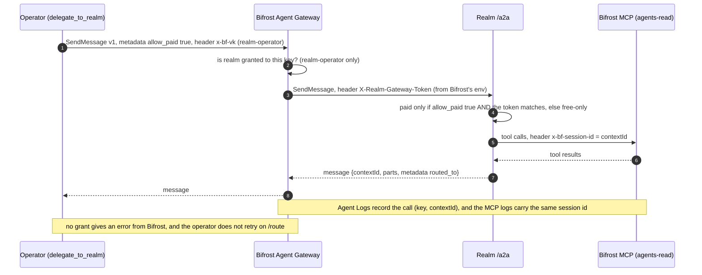

# Flow: Realm of Agents — A2A dispatch (B17)

24 corpus-backed specialists in five Norse-named groups behind an A2A surface. Gná routes a task to the best agent;
leads act on their own specialty or delegate to their team and reconcile. The Operator reaches the Realm through a
single `delegate_to_realm` tool, which since B249 (2026-11-19) goes through Bifrost's Agent Gateway (second diagram).
A paid turn runs on Claude Haiku (`wl-agentic` LiteLLM lane); every hop is an MLflow trace.

## The operator's hop through Bifrost's Agent Gateway (B249)

Runbook: [runbooks/realm-of-agents.md](../runbooks/realm-of-agents.md) § Through Bifrost's Agent Gateway.
Decision: [ADR-0015](../adr/0015-adopt-bifrost-agent-gateway-for-the-realm.md).

Demo: [demos/realm-of-agents.md](../demos/realm-of-agents.md). Concept: [concepts/realm-of-agents.md](../concepts/realm-of-agents.md).
