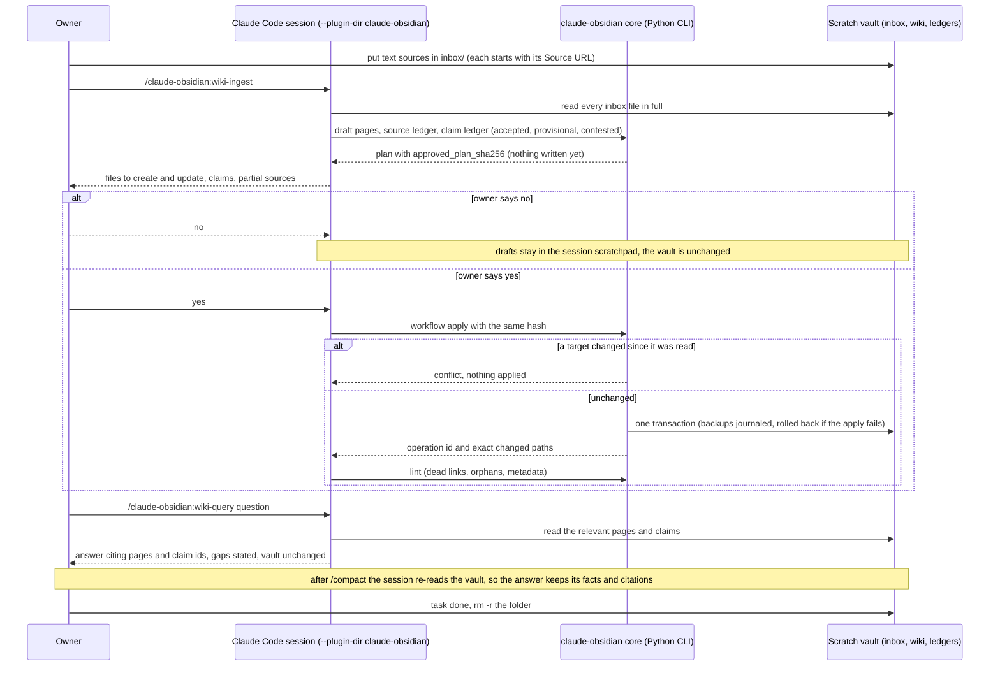

# Flow — research scratch vault (B187)

A throwaway claude-obsidian vault for one research task, on rogueone. Sources go in, Claude writes cited notes, and
questions are answered from those notes. Nothing is written until the owner approves the exact plan. The vault is
deleted when the task ends. Operate: [runbooks/research-scratch-vault.md](../runbooks/research-scratch-vault.md).

- **Approval binds to the plan.** The hash covers the exact operation; a changed plan needs a new approval.
- **Disagreement stays visible.** A claim with a supporting and a contradicting source is recorded as `contested`, and
  query answers report both sides.
- **Scratch only.** Never pointed at the shared agent memory or the owner's own vault.
