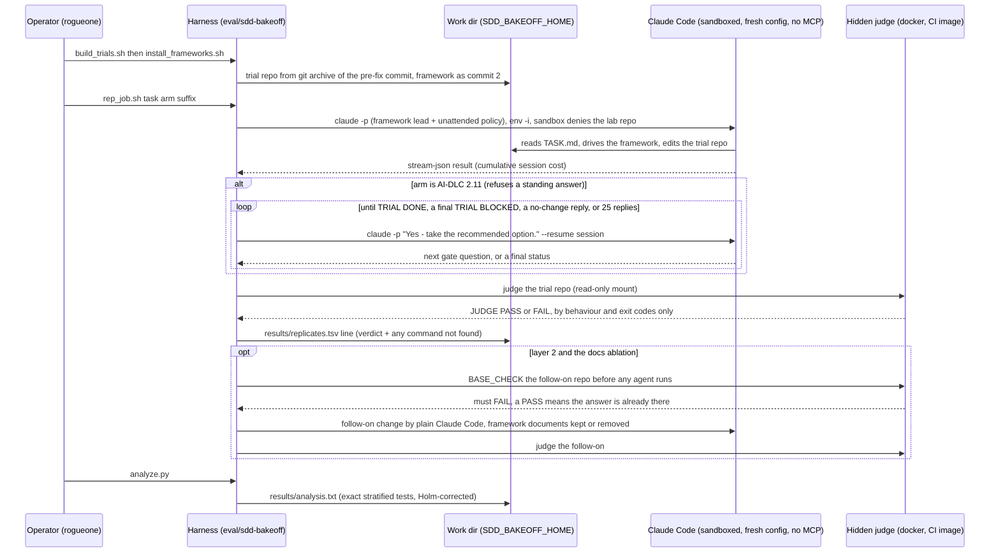

# Flow: SDD framework bake-off, one trial (B86)

One trial of the bake-off, from a clean repo to a judged, costed result. The non-obvious parts are the isolation (the
trial can see neither the lab repo nor the operator's config), the AI-DLC 2.11 click-through driver (it answers each
gate in a new turn, and stops on a final status), and the fail-closed judging: hidden behaviour judges, a base check
before every derived run, and stats that count a driven run only up to its first final status. Harness:
`eval/sdd-bakeoff/`; runbook [runbooks/sdd-frameworks.md](../runbooks/sdd-frameworks.md); verdict
[concepts/spec-driven-frameworks.md](../concepts/spec-driven-frameworks.md).

**Why this shape:**
- **Isolation over trust.** Each trial gets an `env -i` environment, a fresh `CLAUDE_CONFIG_DIR`, `--strict-mcp-config`
  with no servers, and a bubblewrap sandbox. The sandbox denies `~/IdeaProjects`, so a trial cannot read the real fix.
- **The judge never reads prose.** It runs the trial's code against hidden cases. A framework that writes a beautiful
  spec and wrong code fails.
- **The driver exists only for AI-DLC 2.11.** Every other arm gets one prompt. The driver's stop rule and the stats'
  truncation are pinned in `scripts/tests/sdd-bakeoff.bats`, because the first version over-replied 15 times on one run.
