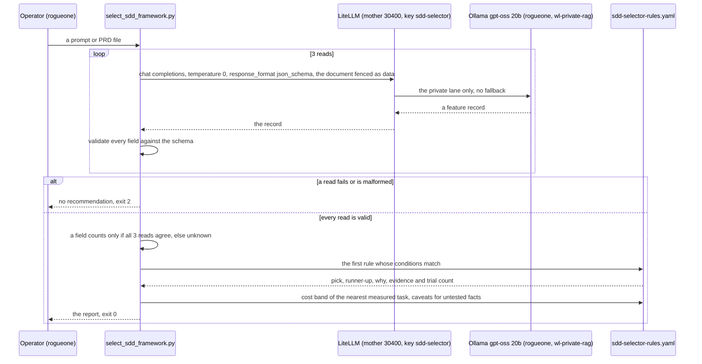

# Flow: the SDD framework selector (B86.1)

A prompt or PRD in; a recommendation (a spec-driven framework, or none) out. The LLM only EXTRACTS a fixed feature
record, on the PRIVATE lane `wl-private-rag` (LAN Ollama only, no fallback, B234), because a PRD may be private. The
versioned rules in `scripts/sdd-selector-rules.yaml`, calibrated on the B86 bake-off, decide. The non-obvious parts:
- **Three reads, and a field counts only when all three agree.** The model at temperature 0 with a fixed seed still
  flipped fields between reads of the same brief.
- **Fail closed.** No key, no address, an unreachable model or a malformed answer is exit 2, never a default pick.
- **A fact no trial covered is a caveat**, never a rule.

Runbook [runbooks/sdd-frameworks.md](../runbooks/sdd-frameworks.md) § Pick a framework; verdict
[concepts/spec-driven-frameworks.md](../concepts/spec-driven-frameworks.md).

**Why the rules are so short.** The bake-off measured plain Claude Code as the cheapest passing arm on every task, so
the default is `none`. The one measured reason to pick a framework is an area that will keep changing: OpenSpec, whose
documents make later changes about 12% cheaper. A framework the document names is a stated constraint and is reported
as such. Everything else the bake-off didn't cover (real product discovery, several teams, large or regulated work)
is a caveat that names the gap.
