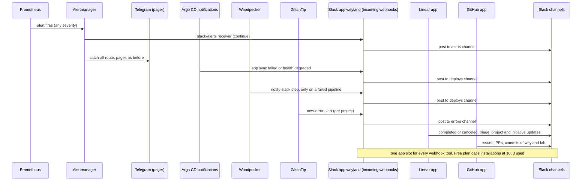

# Flow: Slack — the feed beside the pager (B184)

Five channels in a free Slack workspace show what the platform is doing. Telegram still pages; Slack posts carry no
@mentions, so nothing pings twice. Runbook: [slack.md](../runbooks/slack.md); concept:
[concepts/slack.md](../concepts/slack.md).

- **No inbound path.** Every arrow into Slack is outbound from the lab or from a vendor's cloud. Slack never calls
  the LAN, so slash commands and buttons are not used.
- **Webhook URLs are secrets.** Sealed for the cluster readers, a Woodpecker repo secret for CI, pasted by the owner
  into the Kuma and GlitchTip UIs. Never in git.
