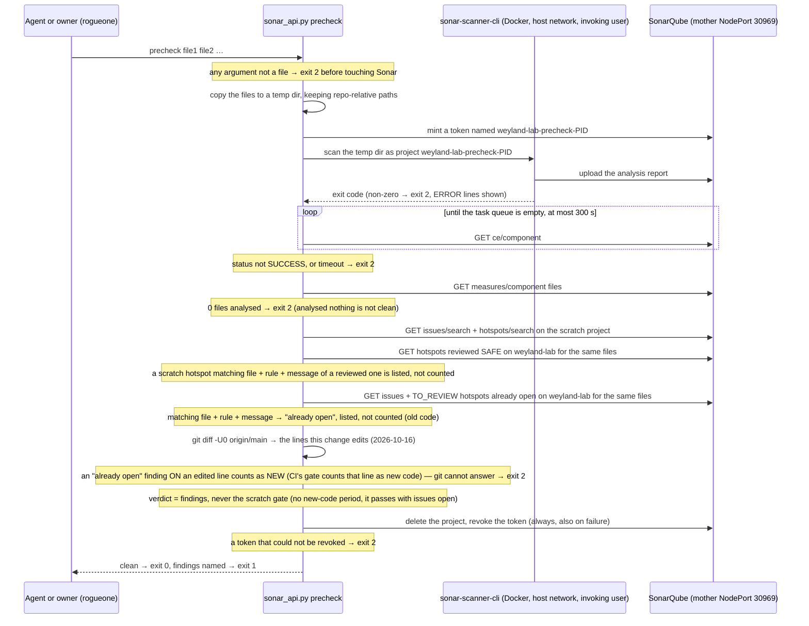

# Flow: SonarQube pre-check before handoff (2026-10-13)

`scripts/sonar_api.py precheck <file>...` runs the CI gate's rules on changed files before a handoff, in a throwaway
project. Two choices in it are not obvious, so they are drawn: the scanner returns before Sonar has processed the
report (so it waits), and a scratch project's gate passes with issues open (so the verdict is the findings).
Runbook: [code-quality.md](../runbooks/code-quality.md). Demo: [sonar-precheck.md](../demos/sonar-precheck.md).

