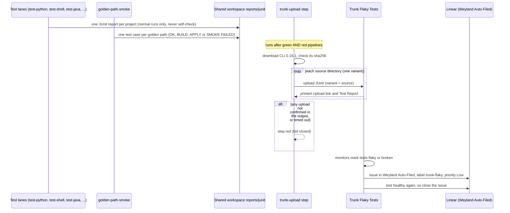

# Flow: CI test results → Trunk Flaky Tests → Linear (B189)

Every pipeline's test results reach Trunk, which keeps each test's history and files a Linear issue when a test turns
flaky or broken, then closes it when the test is healthy again. Runbook:
[trunk-flaky-tests.md](../runbooks/trunk-flaky-tests.md). Verdict: [test-visibility.md](../concepts/test-visibility.md).

- **The CLI's exit code is not the verdict.** It exits 1 when tests failed (the upload still landed), 70 when refused,
  and has exited 0 after a failed upload. `trunk-upload.sh` reads the printed output instead.
- **Self-check runs never report.** Their deliberate failure would reach Trunk as a test that fails every build.
- **`shell-tests` does not report.** It runs the same `scripts/tests` as `test-shell`, which does.
