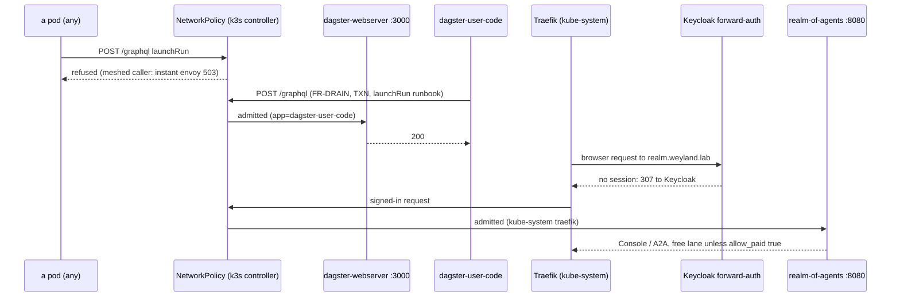
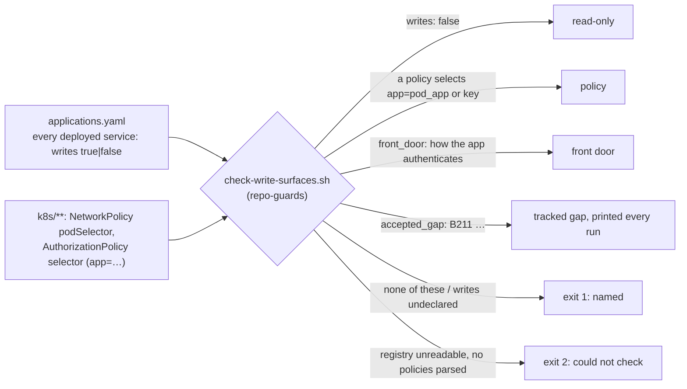

# Flow — write surfaces and their front doors (B209)

Who may change state, and what refuses everyone else. Design: [design/write-surfaces.md](../design/write-surfaces.md);
runbook: [runbooks/write-surfaces.md](../runbooks/write-surfaces.md); demo: [demos/act-guard.md](../demos/act-guard.md)
§ Write surfaces.

## A call to a write surface

## Keeping it closed

- **Why NetworkPolicy, not Istio, here:** Traefik, port-agent and store-scaler are unmeshed, so they have no SPIFFE
  identity for an AuthorizationPolicy to name. A principal-based ALLOW would have refused the Dagster UI.
- **Labels are the identity:** `scripts/tests/write-surface-netpol.bats` pins each policy's target and its exact
  callers against the Deployments' pod labels, so a typo can't silently open a surface or lock a caller out.
