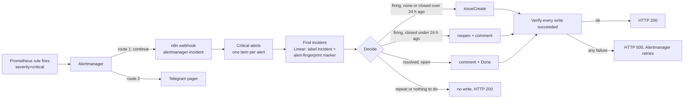

# Alert → Linear incident runbook (U14, EMA-16)

Every **critical** Alertmanager alert also becomes a Linear issue: one issue per alert (its fingerprint), opened when
it fires, commented and closed when it resolves, reopened if it fires again within 24 h. Telegram stays the pager;
this is the record. Built 2026-11-04.

| | |
|---|---|
| What runs | n8n workflow `alert-to-linear (U14)`, id `U14alertToLinear`, in the `n8n` namespace |
| Source of truth | `nodes/mother/lab/weyland-platform/k8s/n8n/workflows/alert-to-linear.json` (git). The live copy is an import of it |
| Trigger | Alertmanager receiver `linear-incidents` → `POST http://n8n.n8n.svc.cluster.local:5678/webhook/alertmanager-incident` (`send_resolved: true`) — `k8s/monitoring/kube-prometheus-stack-values.yaml` |
| Writes | Linear team EMA, project Weyland Lab, label `incident`, priority Urgent, title `U14 incident — <alertname> (<namespace>)` |
| Key | n8n credential **`Linear write key`** (Header Auth, `Authorization: <key>`): a dedicated Linear key, team EMA only. Lives encrypted in n8n's SQLite (`N8N_ENCRYPTION_KEY`), never in git |
| Who can call it | NetworkPolicy `n8n-front-door-only` (`k8s/n8n/netpol.yaml`): Traefik (the SSO'd UI) and the Alertmanager pods only |
| Alert when it breaks | the workflow answers **500** on any failure, so Alertmanager retries and `AlertmanagerFailedToSendAlerts` (warning, Telegram) fires |

## How it works



- **The routing trap.** In Alertmanager a matching child route claims the alert even with `continue: true`; the
  parent's default receiver only fires when NO child matches. So the incident route is followed by an explicit
  `severity="critical"` → `telegram` route, or Telegram would stop paging criticals. Prove any route change:

  [rogueone]
  ```
  python3 -c "import yaml,sys;yaml.safe_dump(yaml.safe_load(open('/home/edwardmangini/IdeaProjects/weyland/nodes/mother/lab/weyland-platform/k8s/monitoring/kube-prometheus-stack-values.yaml'))['alertmanager']['config'],open('/tmp/am.yaml','w'))" && for t in "severity=critical" "severity=warning"; do docker run --rm -v /tmp/am.yaml:/c/am.yaml:ro --entrypoint amtool quay.io/prometheus/alertmanager:v0.32.2 config routes test --config.file=/c/am.yaml alertname=X $t; done
  ```
  Expect `linear-incidents,telegram` then `telegram`.
- **Dedup.** The issue description ends with `alert-fingerprint: <fp>`; the lookup is label `incident` + that marker
  + any state but Canceled/Duplicate. Alertmanager re-sends a firing group every `repeat_interval` (4 h) and re-sends
  resolved ones too; both are no-ops when the issue is already in the right state.
- **Canceling an incident** in Linear takes it out of the lookup, so a later firing opens a fresh one.
- **Why every step has an error output.** With the webhook answering from a Respond node, a run that ERRORS still
  answers 200 (found in the rehearsal), which would hide every failure. Each step's error output goes to
  `Respond failure` (500). A run with nothing to do reaches no Respond node, which n8n answers 200.

## Install or restore (owner steps)

The same three steps install it the first time and restore it after n8n's data is lost. Order matters: the import
binds the workflow's credential **by name**, so the credential must exist first. The rule (n8n 2.29,
`replaceInvalidCredentials`): the id in the file is tried first, then a credential with **exactly** that name and type
(`httpHeaderAuth`), and only when exactly ONE exists in the workflow's project. Anything else leaves the reference
dangling and every run answers 500 `Credential with ID "u14LinearWriteKy" does not exist` (the first live install,
2026-11-04: the credential's name did not match the file's). After the import, the credential's card on the
Credentials tab shows a usage badge (🔗 1); no badge = not bound.

1. **Key.** In Linear, Settings → Security & access → API → new personal API key named `n8n alert-to-linear (U14)`,
   access limited to team **EMA**, with write access (it creates issues and comments and changes issue state).
2. **Credential.** In n8n (https://n8n.weyland.lab), Credentials → Create → **Header Auth**. Name it exactly
   `Linear write key`; header name `Authorization`; value the key.
3. **Import, publish, restart.** n8n loads published workflows only at start, hence the pod delete (the Deployment is
   `Recreate`; never `rollout restart`, Argo would revert the annotation):

   [rogueone]
   ```
   kubectl -n n8n exec -i deploy/n8n -- n8n import:workflow --input=/dev/stdin < /home/edwardmangini/IdeaProjects/weyland/nodes/mother/lab/weyland-platform/k8s/n8n/workflows/alert-to-linear.json && kubectl -n n8n exec deploy/n8n -- n8n publish:workflow --id=U14alertToLinear && kubectl -n n8n delete pod -l app=n8n
   ```
   Ready when the new pod's log says `Activated workflow "alert-to-linear (U14)"` (`/healthz` answers earlier,
   and a webhook call before that line gets a 404):

   [rogueone]
   ```
   kubectl -n n8n logs deploy/n8n | grep "Activated workflow"
   ```

Re-importing is safe: the fixed id `U14alertToLinear` overwrites the same workflow.

## Test it end to end (fires a real critical alert)

Posts a critical test alert straight to Alertmanager from a one-off pod (Alertmanager has no NodePort, and exec into
its 128Mi pod risks OOM-killing it). Telegram pages for it: that is the check that the pager is unchanged.

[rogueone]
```
kubectl -n monitoring run u14-test-alert --rm -i --restart=Never --image=quay.io/prometheus/alertmanager:v0.32.2 --command -- amtool alert add --alertmanager.url=http://monitoring-kube-prometheus-alertmanager.monitoring:9093 alertname=U14TestAlert severity=critical namespace=n8n --annotation=summary='U14 test alert' --annotation=description='Fired by docs/runbooks/alert-to-linear.md; resolves by itself after 5 min.'
```

Expect within ~1 min: a Telegram message, and one Linear issue `U14 incident — U14TestAlert (n8n)`. Run the command a
second time inside 5 min: still one issue. With no end time the alert resolves after Alertmanager's
`resolve_timeout` (5 min); the resolved notification follows at the next group interval (up to 5 min more), and the
issue gets a `Resolved at …` comment and moves to Done. Leave it: the Done issue is the test's record.

## Change the workflow

Edit in the n8n UI, then export it back over the git copy and commit (the export carries a credential *reference*,
never the key; confirm nothing secret rode along before committing). Export to a file in the pod, never to stdout:
n8n prints `Error tracking disabled …` on stdout first, which corrupts a redirected export (found 2026-11-04).

[rogueone]
```
kubectl -n n8n exec deploy/n8n -- n8n export:workflow --id=U14alertToLinear --pretty --output=/tmp/alert-to-linear.json && kubectl -n n8n exec deploy/n8n -- cat /tmp/alert-to-linear.json > /home/edwardmangini/IdeaProjects/weyland/nodes/mother/lab/weyland-platform/k8s/n8n/workflows/alert-to-linear.json && grep -ciE "lin_api|password|secret" /home/edwardmangini/IdeaProjects/weyland/nodes/mother/lab/weyland-platform/k8s/n8n/workflows/alert-to-linear.json
```
Expect `0`. The Linear team, project, label and state ids are constants at the top of the `Critical alerts` step.

## Troubleshooting

| Symptom | Cause / fix |
|---|---|
| `AlertmanagerFailedToSendAlerts` for `integration="webhook"` | n8n answered 500 or was unreachable. n8n UI → Executions shows the failing step and its error. A Linear 401 = the key was revoked: re-do step 1–2 (same credential name), no re-import needed |
| Telegram paged, no Linear issue, no Alertmanager failure | the alert is not `severity=critical`, or the workflow is unpublished (Executions empty). Re-run step 3 |
| 500 `Credential with ID … does not exist` | the import did not bind the credential: its name is not exactly `Linear write key`, it is not Header Auth, or two share the name. Fix the credential, then re-run step 3 |
| 404 from the webhook | n8n is starting and has not activated the workflow yet, or it was never published |
| A duplicate issue | someone edited the `alert-fingerprint:` line out of the description, or canceled the first issue |
